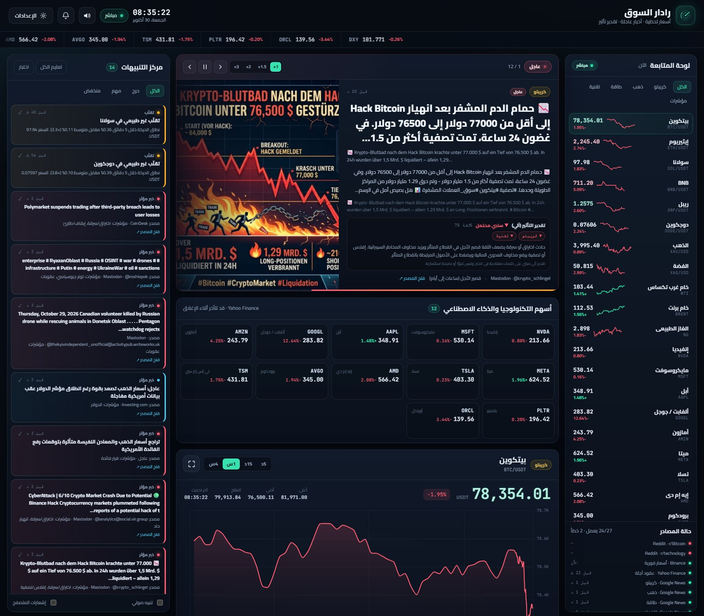

# رادار السوق · Market Radar

منصة عربية (RTL) مفتوحة المصدر لمتابعة **العملات الرقمية والذهب والطاقة وأسهم التكنولوجيا والذكاء الاصطناعي** في صفحة واحدة: أسعار لحظية، رسوم بيانية، أخبار عاجلة بالصور، ترجمة عربية، وتقدير تأثير آلي.

[](LICENSE)
[](https://nodejs.org/)
[](package.json)
[](public/index.html)

**النسخة الحية:** [https://github.com/theeteempire/market-radar#deploy](https://github.com/theeteempire/market-radar#deploy) · **صفحة المشروع:** [https://theeteempire.github.io/market-radar/](https://theeteempire.github.io/market-radar/) · **GitHub:** [https://github.com/theeteempire/market-radar](https://github.com/theeteempire/market-radar)



*لقطة حقيقية من التشغيل الحي: 24 أصلًا، 12 سهم تقنية، 140 خبرًا، 27 مصدرًا — واجهة سطح المكتب 1600×1400.*

> **تنبيه:** كل البيانات لأغراض معلوماتية فقط وليست نصيحة استثمارية. الأسعار قد تتأخر حسب المصدر، وأسعار الذهب والطاقة **عقود آجلة** وليست السعر الفوري. «تقدير التأثير» محرك كلمات مفتاحية وليس تنبؤًا.

<details>
<summary><strong>English summary</strong></summary>

Market Radar is a zero-dependency Node.js dashboard with an Arabic RTL interface. It tracks crypto (Binance, 1s), gold/energy/macro/tech equities (Yahoo Finance chart API, 20s), aggregates RSS/Google News/Reddit/Mastodon/Hacker News, optionally reads X API v2, translates non-Arabic headlines to Arabic, enriches missing images via `og:image`, and produces a deterministic keyword-based impact estimate. It is not investment advice and does not execute trades. MIT licensed.

</details>

---

## 1. ما الذي يقدّمه فعليًا

| القدرة | الحالة | التفاصيل |
|---|---|---|
| أسعار كريبتو لحظية | ✅ | Binance REST كل **1 ثانية** — 6 أصول |
| ذهب/فضة/نفط/غاز/دولار | ✅ | Yahoo Finance `v8/chart` كل **20 ثانية** — 6 أدوات |
| أسهم تقنية وذكاء اصطناعي | ✅ | 12 سهمًا: NVDA, MSFT, AAPL, GOOGL, META, AMZN, TSLA, AMD, AVGO, ORCL, TSM, PLTR |
| رسوم بيانية تفاعلية | ✅ | Chart.js محلي، مدى 5د/15د/1س/4س، تكبير كامل |
| شريط أسعار متحرك | ✅ | كل الأصول مع نسبة التغير |
| تدفق أخبار | ✅ | 23 خلاصة + Mastodon + X اختياري |
| شريط «عاجل» دوّار | ✅ | صور حقيقية، ترجمة، تقدير تأثير، سرعات 1×–3×، إيقاف/سابق/تالي |
| صور الأخبار | ✅ | من الخلاصة (`media:content`, `enclosure`, ``) ثم `og:image` عند الحاجة |
| ترجمة عربية | ✅ | Google Translate غير الرسمي، تخزين مؤقت، كشف لغة تلقائي، قابلة للتعطيل |
| تقدير التأثير | ✅ | قواعد ثنائية اللغة: اتجاه، ثقة، أصول متأثرة، سبب، إخلاء مسؤولية |
| تصنيف الأخبار | ✅ | كريبتو / ذهب / طاقة / تقنية / اقتصاد / عام |
| تنبيهات حركة السعر | ✅ | نوافذ 1د/5د/15د + حساسية قابلة للضبط |
| تنبيهات تقلّب | ✅ | نطاق 5 دقائق مقابل متوسط 35 دقيقة |
| تنبيهات أخبار | ✅ | كلمات مفتاحية عالية/متوسطة الخطورة |
| حدود سعرية مخصصة | ✅ | لكل أصل: أعلى/أدنى |
| صوت + إشعارات متصفح | ✅ | Web Audio + Notification API |
| PWA / الجوال | ✅ | `manifest.webmanifest`، تخطيط متجاوب، إضافة للشاشة الرئيسية |
| X / Twitter | ⚠️ اختياري | يتطلب `X_BEARER_TOKEN` رسميًا — لا كشط |
| Telegram | ⚠️ اختياري | يتطلب بوتًا ومعرّف محادثة |
| حفظ الإعدادات | ✅ | `data/settings.json` بكتابة ذرّية |
| تصدير لقطة JSON | ✅ | `/api/export` |

---

## 2. التشغيل السريع

### المتطلبات

- **Node.js 20 أو أحدث** (تم التطوير والاختبار على Node 26).
- اتصال إنترنت.
- **لا حاجة إلى `npm install`** — المشروع بلا أي اعتماديات npm.

### ويندوز

```bat
run.bat
```

أو:

```powershell
.\start.ps1
```

### يدويًا (أي نظام)

```bash
git clone https://github.com/theeteempire/market-radar.git
cd market-radar
node server.js
```

ثم افتح: `http://127.0.0.1:8787/`

### التحقق

```bash
node --test tests/          # 35 اختبارًا
node scripts/check-sources.js   # فحص حي للمصادر
```

### الإيقاف

`Ctrl+C` — يوجد إغلاق آمن ينهي اتصالات SSE والمزوّدات.

---

## 3. كيف تستخدم الواجهة؟

1. **لوحة المتابعة** على اليمين: 24 أصلًا. اضغط أي أصل لعرض رسمه. الفلاتر: الكل/كريبتو/ذهب/طاقة/تقنية/مؤشرات.
2. **شريط «عاجل»** في الوسط: يتبدّل تلقائيًا بعد زمن قراءة تقديري. استخدم `1× 1.5× 2× 3×` لتغيير السرعة، وزر الإيقاف لتعطيل التبديل.
3. **قسم التقنية**: 12 سهمًا مع سعر وتغيّر ومخطط مصغّر. اضغط أي بطاقة لعرضها في الرسم الكبير.
4. **تدفق الأخبار**: فلتر حسب الفئة أو «عاجل» أو `X`، وابحث في العربية والإنجليزية. كل خبر يعرض صورة، عنوانًا عربيًا، النص الأصلي، المصدر، والزمن النسبي، وتقدير التأثير.
5. **مركز التنبيهات**: فلتر حسب الخطورة، «تعليم الكل»، واختبار تنبيه. فعّل الصوت أو إشعارات المتصفح من المفاتيح أسفل اللوحة.
6. **الإعدادات**: الحساسية، تنبيهات الأخبار، الحدود السعرية، وحالة التكاملات والمصادر.

> الواجهة تُحدّث الزمن النسبي كل ثانية، لكن **مصادر الأخبار تُسحب كل 2–4 دقائق**. «كل ثانية» لا تعني سحب كل موقع كل ثانية — هذا مستحيل بسبب حدود المعدل وشروط المنصات.

---

## 4. مصادر البيانات والتحديث

| المصدر | يغطي | الفترة | ملاحظات |
|---|---|---|---|
| Binance `/ticker/24hr` | BTC, ETH, SOL, BNB, XRP, DOGE | **1 ثانية** | واجهة عامة، قد تُحدّ المعدل |
| Binance `/klines` | تهيئة سلسلة 4 ساعات | عند البدء | 240 شمعة دقيقة |
| Yahoo `/v8/finance/chart` | `GC=F`, `SI=F`, `CL=F`, `BZ=F`, `NG=F`, `DX-Y.NYB` | **20 ثانية** | عقود آجلة/مؤشر، واجهة غير رسمية |
| Yahoo `/v8/finance/chart` | 12 سهم تقنية | **20 ثانية** | قد تتأخر أثناء إغلاق السوق |
| Google News RSS | 10 استعلامات (عربي/إنجليزي) | 2 دقيقة | يغطي مواقع بلا RSS |
| RSS مباشر | CoinDesk, Cointelegraph, TechCrunch, The Verge, Ars Technica, BBC, الجزيرة, OilPrice, Investing.com, Hacker News | 2–4 دقائق | مصادر أصلية |
| Reddit | r/CryptoCurrency, r/Bitcoin, r/technology | 4 دقائق | قد يعيد HTTP 429 |
| Mastodon | 6 وسوم عامة | 3 دقائق | خطوط زمنية عامة فقط |
| X API v2 | حسب الاستعلامات | 5 دقائق | اختياري، رسمي فقط |

الجدول الكامل ونتائج الفحص في [`docs/SOURCES.md`](docs/SOURCES.md).

---

## 5. الترجمة والصور وتقدير التأثير

### الترجمة

- تُترجم العناوين غير العربية دائمًا، والملخصات للعاجل/المهم فقط (`TRANSLATE_SUMMARIES=auto`).
- تستخدم نقطة Google العامة غير الرسمية `clients5.google.com` (نفس محرّك إضافة Chrome) مع `sl=auto`، ودمج حتى 20 نصًا في طلب واحد، وتخزين مؤقت، وحد تزامن 3، وحد 90 طلبًا/دقيقة، وإعادة محاولة تلقائية عند 429/5xx. النتيجة: 200/200 عنوان عربي في التشغيل الحي دون أي فشل.
- **الخصوصية:** نصوص الأخبار غير العربية تُرسل إلى خدمة خارجية. عطّلها بـ `TRANSLATE_ENABLED=0`.
- تُعرض دائمًا بعلامة «ترجمة آلية»، ويبقى النص الأصلي ظاهرًا.

### الصور

- تُستخرج من `media:content` / `media:thumbnail` / `enclosure` / `` في الخلاصة.
- عند غيابها، تُجلب `og:image` أو `twitter:image` من صفحة الخبر بحد أقصى 30 طلبًا/دقيقة وذاكرة 800 عنصر.
- لا تُصنع صور وهمية. عند تعذّر الصورة يظهر بديل تصميمي حسب الفئة.
- بعض المواقع تحجب الجلب (403) أو لا توفر `og:image`؛ هذا طبيعي.

### تقدير التأثير

- محرك قواعد ثنائي اللغة (عربي/إنجليزي) يطابق كلمات مثل: رفع/خفض الفائدة، تضخم، أوبك، حرب، اختراق، ETF، قيود تصدير، طلب AI، أرباح، ركود.
- يعيد: الاتجاه (`إيجابي/سلبي/متأرجح/محايد`)، الثقة، الأصول المتأثرة، السبب، وأفق زمني.
- يُصنّف الخبر «عاجلًا» عند وجود محفّز قوي أو أهمية ≥74.
- **ليس تنبؤًا ولا نصيحة استثمارية.** القواعد شفافة وقابلة للمراجعة في `src/impact.js`.

---

## 6. محرك التنبيهات

### حركة السعر

| الفئة | 1 دقيقة | 5 دقائق | 15 دقيقة |
|---|---|---|---|
| كريبتو | 0.55% | 1.40% | 2.20% |
| ذهب | 0.12% | 0.32% | 0.60% |
| طاقة | 0.25% | 0.65% | 1.10% |
| تقنية | 0.20% | 0.55% | 0.95% |
| مؤشرات | 0.08% | 0.20% | 0.40% |

مضاعف الحساسية: هادئ ×1.6، متوازن ×1.0، حساس ×0.65. تهدئة 8 دقائق لكل أصل/نافذة.

### التقلّب

مقارنة نطاق 5 دقائق بمتوسط 35 دقيقة. ينطلق عند ×3 مع حد أدنى للنطاق. تهدئة 10 دقائق.

### الأخبار

- **حرج:** اختراق/سرقة، ETF/موافقة تنظيمية، إفلاس، حرب، عقوبات، أوبك، فائدة، إيقاف سحب، حظر.
- **مهم:** كلمتان متوسطتان (فيدرالي، تضخم، وظائف، أرباح، تنظيم، دولار، طاقة).
- **منخفض:** كلمة متوسطة واحدة.

قيود: 10 تنبيهات/5 دقائق (20 للحرجة)، تهدئة 10 دقائق لكل كلمة، ومنع تكرار نفس الخبر.

### الحدود السعرية

لكل أصل حد أعلى و/أو أدنى. ينطلق عند **العبور** فقط. تهدئة 30 دقيقة لكل اتجاه.

---

## 7. واجهات API

| المسار | الطريقة | الوصف |
|---|---|---|
| `/api/health` | GET | صحة الخادم، العدّادات، حالة المصادر، الذاكرة |
| `/api/snapshot` | GET | لقطة كاملة: أصول + سلاسل + أخبار + تنبيهات + إعدادات |
| `/api/stream` | GET | بث SSE: `snapshot`, `tick`, `news`, `news_update`, `alert`, `source`, `settings`, `alerts_ack` |
| `/api/series?id=BTCUSDT&range=3600&points=600` | GET | سلسلة سعرية (حتى 4 ساعات) |
| `/api/news?cls=tech&breaking=1&lang=ar&via=x&limit=100` | GET | أخبار مفلترة |
| `/api/alerts?severity=high&unack=1` | GET | تنبيهات مفلترة |
| `/api/alerts/ack` | POST | `{"id":"..."}` أو `{"all":true}` |
| `/api/alerts/test` | POST | إنشاء تنبيه تجريبي |
| `/api/settings` | GET/POST | قراءة/تحديث الإعدادات |
| `/api/export` | GET | تنزيل لقطة JSON |

أمثلة:

```bash
curl http://127.0.0.1:8787/api/health
curl "http://127.0.0.1:8787/api/series?id=NVDA&range=900"
curl "http://127.0.0.1:8787/api/news?breaking=1&limit=5"
```

---

## 8. النشر العام

### Render (موصى به)

المشروع يتضمن `render.yaml` جاهزًا:

1. ارفع المستودع إلى GitHub.
2. Render → **New → Blueprint** → اختر المستودع → **Apply**.
3. اضبط `HOST=0.0.0.0` (موجود في Blueprint).
4. افتح الرابط وتحقق من `/api/health`.

### Docker

```bash
docker build -t market-radar .
docker run -d -p 8787:8787 -e HOST=0.0.0.0 market-radar
```

### GitHub Pages

GitHub Pages **لا يشغّل الخادم**. يستضيف صفحة الهبوط فقط من `docs/`:

- Settings → Pages → Branch `main` → Folder `/docs`.
- الرابط: `https://<username>.github.io/market-radar/`

الدليل الكامل (Railway, Fly.io, VPS, HTTPS, SSE, النطاق المخصص): [`docs/DEPLOY.md`](docs/DEPLOY.md).

---

## 9. الأمان والخصوصية

- الخادم يستمع على `127.0.0.1` افتراضيًا. للنشر العام استخدم `HOST=0.0.0.0` مع HTTPS.
- **لا توجد مصادقة.** أي زائر يستطيع قراءة البيانات وتغيير الإعدادات وإنشاء تنبيهات تجريبية. الإعدادات مشتركة.
- حماية من تجاوز المسارات، رؤوس CSP و`X-Frame-Options` و`Referrer-Policy`، وحد جسم طلب 64KB.
- `.env` مستبعد من Git وDocker. لا تضع أسرارًا في الكود.
- لا تُخزَّن بيانات شخصية. الاستثناء الوحيد: نصوص الأخبار غير العربية تُرسل إلى Google Translate عند تفعيل الترجمة.
- كل خبر يعرض رابط المصدر الأصلي؛ لا يُعاد نشر المقال كاملًا.

---

## 10. البنية

```
market-radar/
├── server.js                  نقطة التشغيل + الإيقاف الآمن
├── src/
│   ├── app.js                 HTTP + SSE + API + الملفات الثابتة
│   ├── config.js              24 أصلًا، 23 خلاصة، عتبات، Mastodon/ترجمة/صور
│   ├── store.js               الحالة في الذاكرة + news_update
│   ├── alerts.js              محرك التنبيهات
│   ├── impact.js              تقدير التأثير وكشف «عاجل»
│   ├── translate.js           ترجمة آلية مخزّنة
│   ├── enrich.js              جلب og:image بأمان
│   ├── pipeline.js            طابور ترجمة + صور بأولوية
│   ├── news-parse.js          RSS/Atom + صور + تصنيف
│   ├── settings.js            حفظ ذرّي
│   ├── http.js                fetch مع مهلة وإعادة محاولة
│   └── providers/
│       ├── crypto.js          Binance
│       ├── yahoo.js           Yahoo Finance
│       ├── news.js            Google News + RSS/Reddit
│       ├── mastodon.js        وسوم Mastodon العامة
│       ├── x.js               X API v2 (اختياري)
│       └── telegram.js        إشعارات Telegram (اختياري)
├── public/
│   ├── index.html             واجهة RTL
│   ├── styles.css             تصميم داكن + استجابة للجوال
│   ├── app.js                 SSE + رسم + عاجل + تقنية + أخبار
│   ├── manifest.webmanifest   PWA
│   └── vendor/chart.umd.min.js
├── tests/                     35 اختبارًا (node:test)
├── scripts/
│   ├── check-sources.js       فحص حي للمصادر
│   └── publish-github.js      نشر عبر GitHub REST API بدون git
├── docs/
│   ├── index.html             صفحة الهبوط العامة
│   ├── DEPLOY.md              دليل النشر
│   ├── SOURCES.md             المصادر والفحص الحي
│   └── ARCHITECTURE.md        التصميم والتدفق
├── Dockerfile / render.yaml / Procfile
└── data/settings.json         يُنشأ تلقائيًا
```

تفاصيل التدفق في [`docs/ARCHITECTURE.md`](docs/ARCHITECTURE.md).

---

## 11. الاختبارات والتحقق

```bash
node --test tests/
```

**آخر نتيجة موثّقة: 35/35 ناجح** — تشمل: محلل RSS والصور، محرك التأثير، الترجمة، إثراء الصور، خط المعالجة، المخزن، وخادم HTTP/SSE.

فحص المصادر:

```bash
node scripts/check-sources.js
```

**آخر نتيجة موثّقة (2026-10-30): 45/47 ناجح.** الفشلان: `Reddit · r/Bitcoin` و`Reddit · r/technology` بـ HTTP 429. الترجمة العربية تعمل، وMastodon يعمل، وكل أسعار Binance/Yahoo تعمل. فشل مصدر أخبار لا يوقف المنصة؛ يعيد المحاولة بتراجع تدريجي حتى 30 دقيقة.

التحقق البصري: Chrome headless على **1600×1150** و**390×844** — لا تمرير أفقي، شريط عاجل بعمود واحد على الجوال، شبكة تقنية بعمودين، وصور محمّلة. لم يُختبر على جهاز لمس حقيقي.

---

## 12. حدود معروفة (بصراحة)

1. **X/Twitter:** لا كشط ولا واجهات غير رسمية. بدون توكن رسمي لا توجد تغريدات — فقط روابط بحث يدوية. الخطة المجانية غالبًا لا تتيح البحث الحديث.
2. **ليست كل الأخبار:** التغطية تعتمد على الخلاصات المتاحة. مواقع تمنع RSS أو تتطلب JS لن تظهر.
3. **الذهب والطاقة آجلة:** `GC=F` و`CL=F` عقود آجلة، وقد تختلف عن السعر الفوري بفارق أساس.
4. **Yahoo واجهة غير رسمية:** قد تتوقف أو تغيّر شكلها دون إشعار.
5. **Reddit:** يحدّ المعدل بصرامة (429). المنصة تتراجع تلقائيًا.
6. **البيانات في الذاكرة:** إعادة التشغيل تمسح السلاسل والأخبار والتنبيهات (تبقى الإعدادات).
7. **الترجمة الآلية:** قد تخطئ، وتعتمد على خدمة غير رسمية قد تُحجب.
8. **الصور:** ليست كل الأخبار لها صورة؛ بعض المواقع تحجب `og:image` أو لا توفره.
9. **تنبيهات المتصفح:** تعمل فقط بعد منح الإذن وغالبًا عندما يكون المتصفح في الخلفية.
10. **لا تنفيذ أوامر تداول:** المنصة للعرض والتنبيه فقط.
11. **لا مصادقة:** النسخة العامة تسمح لأي زائر بتغيير الإعدادات المشتركة.
12. **«كل ثانية»:** تنطبق على واجهة الكريبتو، لا على سحب الأخبار من كل موقع.

---

## 13. استكشاف الأعطال

| العرض | السبب المحتمل | الحل |
|---|---|---|
| «انقطاع — إعادة محاولة» | الخادم متوقف أو المنفذ مختلف | شغّل `server.js` وتحقق من `PORT` |
| لا تظهر أسعار | حجب Binance/Yahoo أو لا إنترنت | `/api/health` ثم `scripts/check-sources.js` |
| مصدر أخبار أحمر | 429 أو حجب مؤقت | طبيعي؛ يتراجع تلقائيًا |
| لا صوت | لم يُفعّل الصوت أو المتصفح يمنع Autoplay | اضغط زر الصوت مرة واحدة |
| لا إشعارات | لم يُمنح الإذن | زر الجرس ثم «السماح» |
| لا صور | الخلاصة بلا صورة و`og:image` محجوب | طبيعي؛ يظهر بديل تصميمي |
| ترجمة إنجليزية فقط | الترجمة معطّلة أو Google حجب | تحقق من `TRANSLATE_ENABLED` و`/api/health` |
| المنفذ مستخدم | تشغيل نسخة أخرى | غيّر `PORT` في `.env` |
| الصفحة تعمل على Render لكن لا بيانات | `HOST` ليس `0.0.0.0` | اضبطه في Environment |
| SSE ينقطع خلف proxy | buffering | `proxy_buffering off` / `flush_interval -1` |

---

## 14. المساهمة

- افتح Issue لوصف الخطأ أو الاقتراح.
- أي تعديل على المصادر أو القواعد يجب أن يحدّث الاختبارات والوثائق.
- حافظ على **صفر اعتماديات npm**.
- لا تضف كشطًا لـ X أو مواقع تمنع الاستخدام الآلي.
- شغّل `node --test tests/` قبل إرسال PR.

---

## 15. الترخيص

[MIT](LICENSE) — مع إشعارات الطرف الثالث. Chart.js 4.4.7 يخضع لترخيص MIT الخاص به. بيانات الأسعار والأخبار والصور والترجمات تبقى ملكًا لمصادرها، وتُعرض العناوين والملخصات مع رابط المصدر فقط.

---

صُنع بواجهة عربية، وبلا أي حزم npm، وبتفاصيل صادقة عن حدود البيانات.
